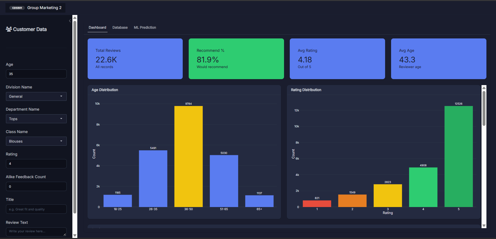

# Customer Behaviour & Marketing Analytics

**Exploring customer satisfaction, product feedback, and recommendation behaviour through R analytics, machine learning, and an interactive Shiny application.**

[**▶ Try the Live R Shiny Application**](https://marketing-2-cds501.shinyapps.io/marketing-app/)

---

## 📌 Project Overview

Developed as a group project for **CDS501 – Principles & Practices of Data Science & Analytics** at **Universiti Sains Malaysia (USM)**, this project analyses clothing reviews to help a retail business understand customer satisfaction and identify potential loyalty risks.

The case study focuses on **Gelugor Fashion Store** and addresses a practical business question:

> How can a clothing retailer increase sales while building customer loyalty?

The project combines exploratory data analysis, sentiment analysis, statistical testing, predictive modelling, and R Shiny deployment to investigate patterns in customer recommendation behaviour.

---

## 🖥️ Live Application



### [🚀 Explore the Live Dashboard](https://marketing-2-cds501.shinyapps.io/marketing-app/)

The deployed application provides:

- **Dashboard** – Explore customer review statistics, ratings, and demographic patterns.
- **Database** – View customer review records and relevant information.
- **ML Prediction** – Predict customer recommendation behaviour using a trained machine learning model.

---

## 🔍 Project Workflow

| Stage | Focus | Description |
|---|---|---|
| **Assignment 1** | Data Preparation & Analysis | Explored customer reviews, product satisfaction, recommendation patterns, and statistical relationships. |
| **Assignment 2** | Predictive Modelling | Developed and evaluated four machine learning models to predict customer recommendations. |
| **Assignment 3** | Storytelling & Deployment | Presented business insights and deployed an interactive R Shiny application. |

---

# 📊 Assignment 1 – Customer Behaviour Analysis

## Dataset Overview

The project uses the **Clothing Reviews Dataset**, containing approximately **23,486 original customer review records**.

The dataset includes:

- Customer age
- Product categories and departments
- Product ratings
- Recommendation indicators
- Review titles and text
- Customer feedback engagement

Data preparation included cleaning, text preprocessing, feature extraction, and sentiment analysis.

## Key Business Insights

### 1. Product Categories & Customer Loyalty

**Which clothing categories have the highest customer satisfaction and recommendation rates?**


**Key Findings:**

- **Jeans and Layering** achieved the highest recommendation rates, approximately **87.9%**.
- These categories also recorded strong average customer ratings of approximately **4.35**.
- **Trend** recorded the lowest recommendation rate, approximately **74.6%**.

**Business Implication:**

High-performing product categories could be prioritised in promotional campaigns and inventory planning, while lower-performing categories may require further investigation into quality, pricing, and customer expectations.

### 2. Negative Reviews & Product Quality

**What issues appear most frequently in negative customer reviews?**


**Key Findings:**

- Frequently occurring terms included **dress, top, fabric, fit, size, and material**.
- These suggest potential concerns involving product fit, sizing consistency, and material quality.
- Dresses received a high volume of both positive and negative feedback.

**Business Implication:**

Retailers could improve product descriptions, sizing guides, and quality monitoring to address recurring sources of dissatisfaction.

### 3. Customer Demographics & Recommendation Patterns

**Which customer age groups are more or less likely to recommend clothing products?**


**Key Findings:**

| Customer Group | Recommendation Rate |
|---|---:|
| Young | **84.81%** |
| Adult | **79.26%** |
| Middle | 81.48% |
| Senior | 84.21% |
| Elderly | 84.52% |

Young customers demonstrated the highest recommendation rate, while adult customers recorded the lowest.

**Business Implication:**

Understanding customer preferences across different age groups can support more targeted marketing strategies and customer-retention initiatives.

### 4. Customer Ratings & Recommendation Behaviour

**Do customers who recommend clothing products provide significantly higher ratings?**


A **Welch Two-Sample t-test** was conducted to compare customer ratings between recommendation groups.

**Results:**

| Customer Group | Average Rating |
|---|---:|
| Recommend | **4.60** |
| Not Recommend | **2.30** |

The test produced a **p-value < 2.2 × 10⁻¹⁶**, indicating a statistically significant difference.

**Business Implication:**

Customer satisfaction and recommendation intention are strongly associated. Addressing issues affecting product ratings may help improve customer experiences and encourage positive recommendations.

---

# 🤖 Assignment 2 – Predictive Modelling

## Objective

Develop machine learning models to predict whether a customer is likely to **Recommend** or **Not Recommend** a clothing product.

The prediction helps identify potential loyalty risks and supports more informed product and customer management decisions.

## Feature Engineering & Selection

The analysis combined structured customer information with features extracted from review text.

Techniques included:

- Text tokenisation and cleaning
- TF-IDF feature representation
- Sentiment analysis using the Bing lexicon
- Chi-square feature selection
- Statistical feature significance testing


The final feature-selection process retained **166 text features**, alongside structured and derived features.

**Sentiment score and product rating** emerged as particularly influential predictors.

## Machine Learning Models

Four classification models were developed:

1. Decision Tree
2. Logistic Regression
3. K-Nearest Neighbours (KNN)
4. Naive Bayes

Models were evaluated using accuracy, precision, recall, F1-score, AUC, confusion matrices, and balanced accuracy.

## Model Performance

| Model | Accuracy | Recall (Not Recommend) | AUC |
|---|---:|---:|---:|
| **Decision Tree** | **94.3%** | **93.7%** | 0.967 |
| Logistic Regression | 93.7% | 81.1% | **0.981** |
| KNN | 86.6% | 27.5% | 0.948 |
| Naive Bayes | 83.0% | 87.2% | 0.923 |

*Results are based on the project's model evaluations. The Naive Bayes recall figure comes from the assignment presentation.*

### Selected Model: Decision Tree

The **Decision Tree** was selected because it demonstrated strong overall performance and effective identification of customers who were unlikely to recommend products.


**Key Results:**

- Accuracy: **94.3%**
- Recall for Not Recommend: **93.7%**
- Balanced Accuracy: **94.1%**
- AUC: **0.967**

Although Logistic Regression achieved a slightly higher AUC, the Decision Tree provided stronger recall for the **Not Recommend** class and more interpretable decision rules.

This makes it particularly useful for identifying potential customer dissatisfaction.

---

# 🌐 Assignment 3 – R Shiny Application

The final stage involved presenting the analytical insights and deploying the recommendation prediction model through an interactive **R Shiny web application**.

## Application Features

### Interactive Dashboard

Explore:

- Total customer reviews
- Overall recommendation percentage
- Average customer rating
- Customer age distribution
- Product rating distribution

### Customer Database

Explore the underlying customer review information through a structured interface.

### Machine Learning Prediction

Enter customer and review information to predict whether a customer is likely to recommend a clothing product.

The application also supports prediction using uploaded CSV data.

### [🚀 Launch the R Shiny Application](https://marketing-2-cds501.shinyapps.io/marketing-app/)

---

## 🛠️ Tools & Technologies

| Category | Tools & Techniques |
|---|---|
| Programming | R |
| Application Development | R Shiny |
| Data Preparation | Data Cleaning, Feature Engineering |
| Text Analytics | NLP, TF-IDF, Sentiment Analysis |
| Statistical Analysis | Hypothesis Testing, Chi-square, Welch t-test |
| Machine Learning | Decision Tree, Logistic Regression, KNN, Naive Bayes |
| Model Evaluation | Accuracy, Precision, Recall, F1-score, AUC |
| Visualisation | R Visualisations, Shiny Dashboard |

---

## 📁 Repository Structure

```text
customer-behaviour-marketing-analytics/
│
├── assignment-1/
│   └── R scripts for data preparation and analysis
│
├── assignment-2/
│   └── R scripts for machine learning and evaluation
│
├── assignment-3/
│   └── R Shiny application and supporting files
│
├── screenshots/
│   ├── shiny-dashboard.png
│   ├── recommendation-rate-by-category.png
│   ├── negative-review-terms.png
│   ├── recommendation-by-age-group.png
│   ├── ratings-by-recommendation.png
│   ├── feature-importance.png
│   └── decision-tree-roc.png
│
└── README.md
```

---

## 🚀 How to Explore the Project

### Option 1 – Live Application

Visit the deployed application:

**[Customer Behaviour & Marketing Analytics – R Shiny](https://marketing-2-cds501.shinyapps.io/marketing-app/)**

### Option 2 – Run Locally

1. Install R and RStudio.
2. Download or clone this repository.
3. Install the required R packages.
4. Ensure the necessary datasets and trained model files are available.
5. Run the scripts for Assignments 1 and 2, or launch the Shiny application from Assignment 3.

Local execution may require additional package dependencies and supporting files used during development.

---

## 👥 Project Contributors

**Course:** CDS501 – Principles & Practices of Data Science & Analytics

**Institution:** Universiti Sains Malaysia (USM)

**Project Type:** Group Academic Project

**Group Members:**
- Muhammad Huzaifah bin Hairul Nizam
- Grace Tan Ying Hui
- Ooi Khel Yin

This project was developed collaboratively as part of the course assignment. The deployed R Shiny application is hosted through a group member's account.

---

## 📝 Project Note

This project is an academic case study demonstrating how customer review analytics and machine learning can support retail business decision-making.

The findings identify patterns and potential improvement opportunities; they do not represent verified changes in actual sales, customer retention, or business performance.
