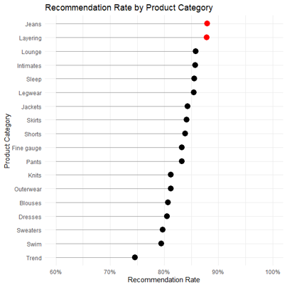
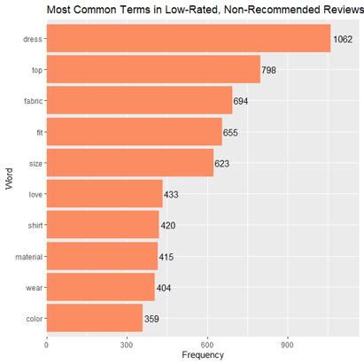
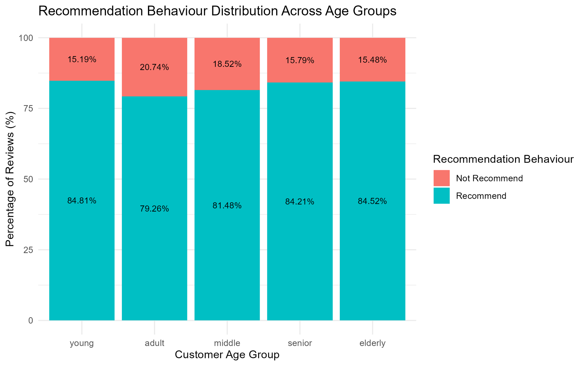
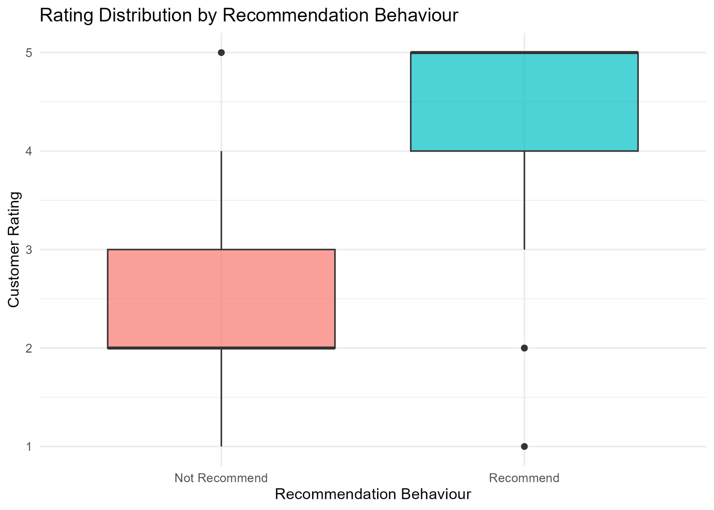
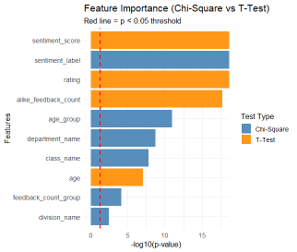
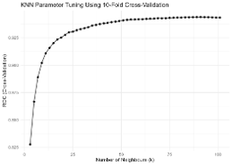

# Customer Behaviour & Marketing Analytics

**Exploring customer satisfaction, product feedback, and recommendation behaviour through R analytics, machine learning, and an interactive Shiny application.**

[**▶ Try the live R Shiny application**](https://marketing-2-cds501.shinyapps.io/marketing-app/)

## Overview

Developed as a group project for **CDS501 – Principles & Practices of Data Science & Analytics** at **Universiti Sains Malaysia (USM)**, this project analyses clothing reviews to help a retail business understand customer satisfaction and identify potential loyalty risks.

The case study considers **Gelugor Fashion Store's** central question: *How can the store increase sales while building customer loyalty?* We used exploratory analysis, sentiment analysis, hypothesis testing, predictive modelling, and an R Shiny deployment to investigate patterns in **recommendation intention**. The dataset does not directly measure future purchases or loyalty outcomes.

## Live Application


**[Open the live dashboard and prediction app →](https://marketing-2-cds501.shinyapps.io/marketing-app/)**

The deployed app contains a dashboard, a database view, and an ML prediction interface. It is hosted by a project teammate.

## Project Stages

| Stage | Focus | What we did |
| --- | --- | --- |
| **Assignment 1** | Data preparation & exploratory analysis | Cleaned reviews, analysed categories and age groups, explored sentiment and review terms, and conducted a Welch t-test |
| **Assignment 2** | Predictive modelling & evaluation | Selected structured and text features, trained four classification models, and compared their ability to identify **Not Recommend** outcomes |
| **Assignment 3** | Storytelling & deployment | Communicated business findings and deployed an interactive **R Shiny** application |

## Assignment 1 — Customer Insights

The original **Clothing Reviews Dataset** contained **23,486 observations** covering customer age, clothing categories, ratings, recommendation indicators, feedback engagement, and review text. Text preprocessing included tokenisation, stop-word removal, lemmatisation, TF-IDF features, and lexicon-based sentiment scoring.

### 1. Which clothing categories receive stronger recommendations?



**Jeans and Layering** had the highest recommendation rates (around **87.9%**), while **Trend** recorded the lowest (around **74.6%**). The findings suggest where product promotion might be prioritised and where customer expectations require closer investigation.

### 2. What concerns appear in negative reviews?



Frequently occurring terms included **dress, top, fabric, fit, and size**. These point toward product-fit and material-quality issues worth examining, particularly for dresses. Word frequencies are *signals*, not proof that every use of these terms was a complaint.

### 3. Does recommendation behaviour differ by age group?



The **young** group had the highest recommendation rate (**84.81%**), while **adults** had the lowest (**79.26%**). This could guide customer-segment research and tailored marketing experiments.

### 4. Do customers who recommend products give higher ratings?



The mean rating was approximately **4.60** for customers who recommended products, compared with **2.30** for customers who did not. A **Welch two-sample t-test** found a statistically significant difference (**p < 2.2 × 10⁻¹⁶**). This is an association, not evidence of causation.

## Assignment 2 — Recommendation Prediction

The models predicted whether a review belonged to **Recommend** or **Not Recommend**, using customer and product attributes, rating, sentiment, engagement indicators, and selected review-text features.

### Feature selection



Text features were filtered using Chi-square statistics; the project retained **166 text features** plus structured and derived features. **Sentiment score and rating** emerged as influential predictors in the feature-selection analysis.

### Model comparison

| Model | Accuracy | Recall for Not Recommend | AUC |
| --- | ---: | ---: | ---: |
| **Decision Tree** | **94.3%** | **93.7%** | 0.967 |
| Logistic Regression | 93.7% | 81.1% | **0.981** |
The project also evaluated **K-Nearest Neighbours** and **Naive Bayes**. KNN had notably weaker recall for the **Not Recommend** class; Naive Bayes was less reliable at identifying loyalty-risk reviews.

**Why Decision Tree?** The project selected it because it combined high accuracy, strong **Not Recommend** recall, and interpretable rules. Although Logistic Regression had the highest AUC, its recall on the loyalty-risk class was lower.



*Decision Tree ROC curve: AUC = 0.967 (from the assignment report).*

## Assignment 3 — R Shiny Deployment

The application brings the analysis into an interactive interface with:

- **Dashboard:** review counts, recommendation proportion, average rating, and customer distributions
- **Database:** a view of the underlying review records
- **ML Prediction:** an interface for generating customer recommendation predictions

[**Launch the R Shiny application →**](https://marketing-2-cds501.shinyapps.io/marketing-app/)

## Tools & Techniques

**R · R Shiny · Data Cleaning · Data Visualisation · NLP · TF-IDF · Sentiment Analysis · Statistical Testing · Classification · Model Evaluation**

Models compared: **Decision Tree, Logistic Regression, KNN, Naive Bayes**.

## Repository Structure

```text
customer-behaviour-marketing-analytics/
├── assignment-1/        # R code: preparation, exploratory analysis, statistics
├── assignment-2/        # R code: feature selection, models, evaluation
├── assignment-3/        # R Shiny source and necessary supporting assets
├── screenshots/         # App screenshot and report figures used in README
└── README.md
```

The three `assignment-*` directories are where the scripts will be uploaded. Adjust the folder names here if your final repository uses a different structure.

## Run the Project

**Online:** Use the [live R Shiny app](https://marketing-2-cds501.shinyapps.io/marketing-app/).

**Locally:** Install R and RStudio, download the repository, install the packages required by the scripts, and ensure the dataset, trained models, and other expected support files are available. Run scripts in assignment order or launch the Shiny entry point in `assignment-3/` using **Run App**. The exact requirements depend on the published source files.

## Contributors

**CDS501 – Principles & Practices of Data Science & Analytics**  
**Universiti Sains Malaysia (USM)**  
**Group project: Marketing 2**

- Muhammad Huzaifah bin Hairul Nizam
- Grace Tan Ying Hui
- Ooi Khel Yin

The work was completed collaboratively. The public R Shiny app is hosted through a teammate's account.

## Academic Note

This is an educational clothing-retail case study. Report charts show analyses of historical review records; they should not be interpreted as real-world changes in a store's revenue, customer retention, or product quality.
